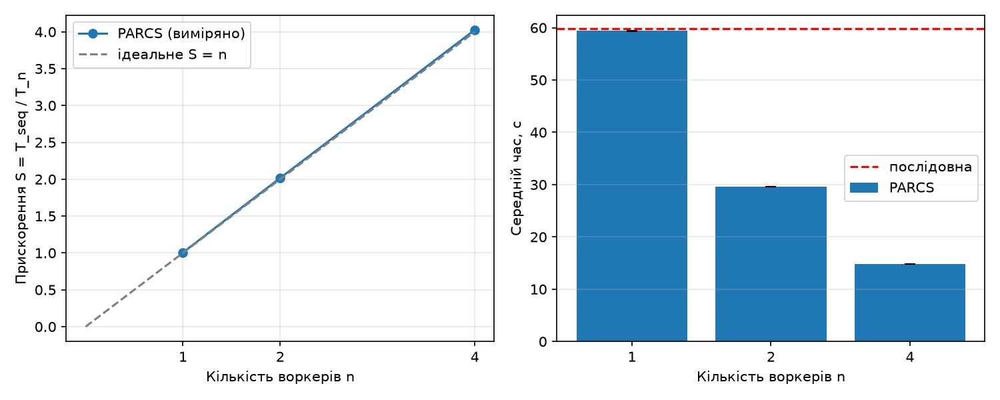

# Комбінаторика на PARCS: C(n, k) і P(n, k) за модулем p

Лабораторна робота 1 з курсу «Хмарні обчислення»: система [PARCS-Python](https://github.com/Hummer12007/parcs-python) у Google Cloud і паралельне (map-reduce) обчислення біноміального коефіцієнта C(n, k) mod p та кількості розміщень P(n, k) mod p.

## Ідея

P(n, k) = n·(n−1)·…·(n−k+1), C(n, k) = P(n, k) / k!. Ділення за модулем простого p замінюється множенням на обернений елемент: C = P · (k!)^(p−2) mod p (мала теорема Ферма; k < p, тому k! не ділиться на p).

- **Послідовна версія:** один прохід по i = 0…k−1, складність O(k).
- **Паралельна версія:** майстер ділить індекси [0, k) на W рівних діапазонів (**map**): воркер рахує часткові добутки чисельника і знаменника за модулем p і повертає 2 числа та свій час. Майстер перемножує їх і застосовує Ферма (**reduce**). Комунікація — кілька чисел, не залежить від k; кожне множення коштує однаково, тому статичного рівномірного поділу досить.
- **Перевірка правильності:** тести проти `math.comb`/`math.perm`; для великих даних n = p−1, тоді за теоремою Вілсона C(p−1, k) ≡ (−1)^k (mod p) — відповідь відома наперед і перевіряється в кожному вихідному файлі (`Wilson check: OK`). Простота p перевіряється тестом Міллера–Рабіна.

## Результати

Заміри на кластері Google Cloud: 1 майстер + 4 воркери `n1-standard-1` (1 vCPU), зона europe-central2-a, середнє за 3 прогони. Дані: n = 2305843009213693950, k = 106000000, p = 2305843009213693951. Відповідь C(n,k) mod p = 1 (збігається з теоремою Вілсона), P(n,k) mod p = 371586108296938858.

| Версія | Воркерів | Прогони, с | Середній час, с | σ, с | Прискорення S = T_seq/T_n | S₁ = T₁/T_n | Ефективність E = S/n |
|---|---|---|---|---|---|---|---|
| Послідовна | — | 59,81; 59,63; 59,85 | 59,76 | 0,12 | 1,00 | — | — |
| PARCS | 1 | 59,43; 59,34; 59,45 | 59,40 | 0,06 | 1,01 | 1,00 | 101 % |
| PARCS | 2 | 29,62; 29,59; 29,67 | 29,63 | 0,04 | 2,02 | 2,00 | 101 % |
| PARCS | 4 | 14,82; 14,83; 14,88 | 14,84 | 0,03 | 4,03 | 4,00 | 101 % |



Прискорення практично лінійне: задача складається з незалежних частин, а між вузлами передаються лише кілька чисел. Ефективність трохи вище 100 %, бо PARCS із 1 воркером на 0,6 % швидший за послідовну версію (різниця близька до розкиду між прогонами). Сирі дані — у `results/big/`, звіт — у [docs/Звіт_PARCS_Комбінаторика.docx](docs/Звіт_PARCS_Комбінаторика.docx).

## Структура

| Шлях | Призначення |
|---|---|
| `solution/combinatorics_parallel.py` | паралельна версія для PARCS (Python 2.7 і 3) |
| `solution/combinatorics_sequential.py` | послідовна версія: з командного рядка і як задача PARCS на майстрі |
| `input/small.txt` | малі дані для демо: C(20,7) = 77520 |
| `input/wilson.txt` | n = p−1, відповідь відома (1) |
| `input/big.txt` | дані для замірів: p = 2^61−1, n = p−1, k підбирається калібруванням |
| `tests/test_combinatorics.py` | тести обох версій |
| `tools/local_run.py` | локальний запуск PARCS-рішення без кластера (лише перевірка логіки) |
| `tools/gcp_up.sh`, `tools/gcp_down.sh` | створення й видалення кластера (з Cloud Shell) |
| `tools/gcp_firewall.sh` | доступ до порту 8080 лише з Cloud Shell і твоєї IP |
| `tools/calibrate.sh` | підбір k для `big.txt` на кластері |
| `tools/run_measurements.sh` | серія замірів через API майстра → `results.csv` |
| `tools/summarize.py` | таблиця, прискорення, ефективність, `speedup.png` |
| `docs/Звіт_PARCS_Комбінаторика.docx` | звіт |

Формат вхідного файлу: один рядок `n k p` (0 ≤ k ≤ n < p, p — просте), рядки з `#` — коментарі.

## Запуск

### Локально (лише перевірка правильності, без Google)

```bash
python -m unittest discover -s tests -v
python solution/combinatorics_sequential.py input/small.txt output.txt
python tools/local_run.py input/wilson.txt output.txt 4
```

### У Google Cloud — усе з Cloud Shell

Усе, що стосується Google, робиться в **Google Cloud Shell** (кнопка `>_` у консолі): `gcloud` там уже є, локально нічого ставити не треба.

```bash
git clone https://github.com/DenysHorshcov/lab_parks && cd lab_parks
bash tools/gcp_up.sh PROJECT_ID 4 europe-central2-a ТВОЯ_IP   # ТВОЯ_IP: https://ifconfig.me на своєму ПК
MASTER=http://$(cat .master_ip):8080                            # через 2-3 хв відкрий $MASTER/workers
bash tools/calibrate.sh $MASTER 10000000 30000000                # підбір k для ~60 с
nano input/big.txt                                               # вписати парне k
nohup bash tools/run_measurements.sh $MASTER input/big.txt results/big 3 "seq 1 2 4" > measure.log 2>&1 &
tail -f measure.log                                              # чекати DONE
pip3 install --user matplotlib; python3 tools/summarize.py results/big/results.csv
bash tools/gcp_down.sh PROJECT_ID europe-central2-a              # ОДРАЗУ видалити кластер
```

Якщо Cloud Shell перепідключився (змінилась його IP-адреса) і майстер перестав відповідати: `bash tools/gcp_firewall.sh PROJECT_ID ТВОЯ_IP`.

Послідовна версія на кластері запускається як звичайна задача PARCS: її `Solver` не використовує воркерів і рахує все на майстрі. Так обидві версії міряються на однакових VM (`n1-standard-1`) і тим самим Python 2.7.

**VM коштують грошей, поки існують**, тому після замірів обов'язково запускай `gcp_down.sh` і перевіряй, що списки VM і дисків порожні.

## Безпека

PARCS приймає й виконує код без пароля, тому порт 8080 і SSH відкриті лише для адреси Cloud Shell і твоєї IP, а VM створюються без сервісного акаунта. Образ `hummer12007/parcs-node` сторонній і працює на Python 2.7, тому кластер тримається ввімкненим лише на час роботи.
