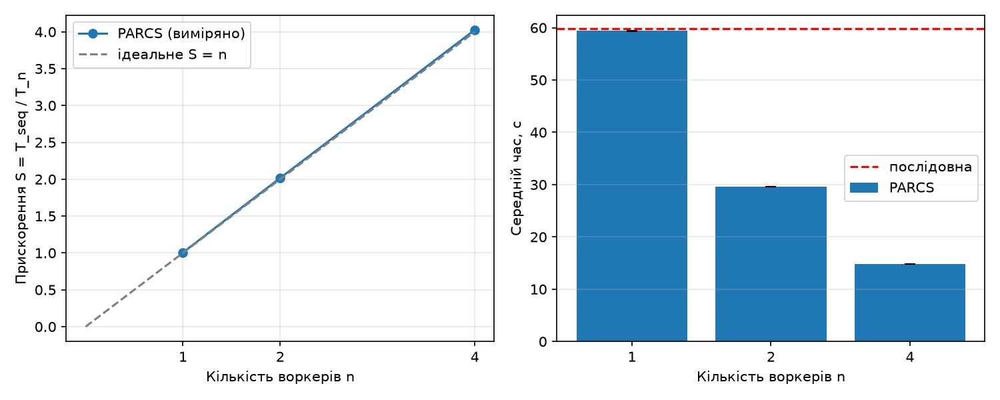

# Звіт до лабораторної роботи 1

**Курс:** Хмарні обчислення
**Тема:** Паралельне обчислення комбінаторних величин C(n, k) mod p і P(n, k) mod p у системі PARCS (Google Cloud)
**Виконав:** ⟨ПІБ, група ТК-42⟩
**Репозиторій:** https://github.com/DenysHorshcov/lab_parks

## 1. Мета і постановка задачі

Мета: розгорнути систему PARCS у хмарному середовищі Google Cloud, реалізувати послідовний і паралельний алгоритми однієї задачі, порівняти їхній час для різної кількості воркерів.

Задача: за трьома числами n, k, p (p — просте, 0 ≤ k ≤ n < p), записаними у вхідний файл, обчислити

- кількість розміщень P(n, k) = n! / (n−k)! = n·(n−1)·…·(n−k+1) за модулем p;
- біноміальний коефіцієнт C(n, k) = P(n, k) / k! за модулем p.

Результат, час роботи і розподіл роботи між воркерами записуються у вихідний файл.

## 2. Алгоритми

### 2.1. Послідовний

```
num = 1; den = 1
для i = 0 … k−1:
    num = num · (n − i) mod p
    den = den · (i + 1) mod p
P = num
C = num · den^(p−2) mod p
```

Складність O(k) множень за модулем + O(log p) на піднесення до степеня.

### 2.2. Паралельний (map-reduce)

1. Майстер ділить індекси [0, k) на W рівних діапазонів [sᵢ, eᵢ), sᵢ = ⌊k·i/W⌋.
2. **Map** (на воркері i): numᵢ = ∏_{j∈[sᵢ,eᵢ)} (n − j) mod p, denᵢ = ∏_{j∈[sᵢ,eᵢ)} (j + 1) mod p; воркер повертає (numᵢ, denᵢ, час).
3. **Reduce** (на майстрі): num = ∏ numᵢ mod p, den = ∏ denᵢ mod p, C = num · den^(p−2) mod p.

Між вузлами передаються лише межі діапазону і три числа відповіді, тому обсяг комунікації не залежить від k. Усі множення однакові за вартістю, тому статичного рівномірного поділу досить (дисбаланс — не більше одного множення).

### 2.3. Правильність

- **Поділ:** діапазони не перетинаються і покривають [0, k), тож кожен множник потрапляє в добуток рівно один раз. Множення за модулем асоціативне й комутативне, тому ∏ᵢ numᵢ ≡ ∏_{j=0}^{k−1}(n−j) = P(n, k) (mod p), аналогічно ∏ᵢ denᵢ ≡ k!.
- **Ділення (мала теорема Ферма):** для простого p і a, не кратного p, a^(p−1) ≡ 1, отже a^(p−2) ≡ a^(−1) (mod p). Оскільки k < p, k! не містить множника p, тому обернений елемент існує і C ≡ P · (k!)^(p−2) (mod p).
- **Перевірка на великих даних (теорема Вілсона):** (p−1)! ≡ −1 (mod p). Звідси C(p−1, k) ≡ (−1)^k (mod p) (бо p−1−j ≡ −(j+1)). Тому для вхідних даних з n = p−1 відповідь відома заздалегідь; кожен вихідний файл містить рядок `Wilson check: OK/FAIL`.
- **Тести** (`tests/test_combinatorics.py`): порівняння з `math.comb`/`math.perm` на випадкових даних для 1, 2, 3, 4, 7, 50 воркерів (зокрема коли воркерів більше, ніж k), граничні випадки k = 0, k = n, перевірка Вілсона, тест простоти, некоректні вхідні файли.

## 3. Реалізація

- `solution/combinatorics_parallel.py` — клас `Solver` у форматі PARCS: `solve()` (на майстрі: читання, поділ, запуск map, reduce, запис), `mymap()` (на воркері, позначений `@expose`), `myreduce()`. Виклики `mymap` асинхронні, тому всі воркери рахують одночасно; `.value` чекає результату.
- `solution/combinatorics_sequential.py` — самодостатня послідовна версія; має і `main()` для командного рядка, і клас `Solver`, тож запускається на майстрі PARCS як звичайна задача.
- Код сумісний з Python 2.7 (образ `hummer12007/parcs-node`): немає f-рядків, `xrange` замість `range`, `math.comb` лише в тестах.
- Простота p перевіряється тестом Міллера–Рабіна з 12 основами (детермінований для p < 3,3·10²⁴).

## 4. Середовище

| Параметр | Значення |
|---|---|
| Хмара | Google Cloud Compute Engine |
| Регіон / зона | europe-central2-a (Варшава) |
| Тип VM | n1-standard-1 (1 vCPU, 3,75 ГБ) |
| ОС | Container-Optimized OS, контейнер `hummer12007/parcs-node` (Python 2.7) |
| Вузли | 1 майстер + 4 воркери |
| Керування | Google Cloud Shell: `tools/gcp_up.sh`, `tools/gcp_down.sh` |

## 5. Методика вимірювань

- Вхідні дані `input/big.txt`: p = 2^61 − 1, n = p − 1, k = 106 000 000 (підібрано `tools/calibrate.sh`: 10·10⁶ → 5,6 с, 30·10⁶ → 16,9 с, тобто лінійно; для ≈ 60 с взято 106·10⁶).
- Вимірюється час від початку `solve()` до запису відповіді (читання файлу, розсилання, обчислення, reduce) — поле `Total time`; час кожного воркера — поле `Worker compute times`.
- Послідовна версія виконується як задача PARCS на майстрі (та сама VM і той самий інтерпретатор).
- Для 1, 2, 4 воркерів зайві воркери вимикаються через API майстра, VM не перестворюються.
- Кожна конфігурація — 3 прогони, береться середнє (`tools/run_measurements.sh`, `tools/summarize.py`).
- Прискорення S = T_seq / T_n, ефективність E = S / n.

## 6. Результати

| Версія | Воркерів | Прогони, с | Середній час, с | σ, с | Прискорення S = T_seq/T_n | S₁ = T₁/T_n | Ефективність E = S/n |
|---|---|---|---|---|---|---|---|
| Послідовна | — | 59,81; 59,63; 59,85 | 59,76 | 0,12 | 1,00 | — | — |
| PARCS | 1 | 59,43; 59,34; 59,45 | 59,40 | 0,06 | 1,01 | 1,00 | 101 % |
| PARCS | 2 | 29,62; 29,59; 29,67 | 29,63 | 0,04 | 2,02 | 2,00 | 101 % |
| PARCS | 4 | 14,82; 14,83; 14,88 | 14,84 | 0,03 | 4,03 | 4,00 | 101 % |



Відповідь у всіх прогонах однакова: C(n,k) mod p = 1 (k парне, тому за Вілсоном 1), P(n,k) mod p = 371586108296938858, перевірка Вілсона — OK у всіх 12 прогонах.

## 7. Аналіз

Виміряне прискорення S = 1,01 / 2,02 / 4,03 для 1 / 2 / 4 воркерів, тобто практично ідеальне S = n; ефективність ≈ 101 %. Причини:

- задача ідеально паралелиться: діапазони незалежні, робота між воркерами ділиться з точністю до одного множення, а між вузлами передаються лише межі діапазону та два-три числа (O(1), не залежить від k);
- накладні витрати PARCS (передача задачі, серіалізація Pyro4, запуск методу, reduce) становлять частки секунди на тлі 15–60 с обчислень, тому закон Амдала майже не проявляється; перші відхилення від ідеалу з'явилися б при значно меншому k;
- розкид між прогонами малий (σ ≤ 0,12 с), VM однакові, тому нерівномірність між воркерами незначна (див. `Worker compute times` у `results/big/output_*`);
- ефективність трохи вище 100 %: PARCS із 1 воркером на 0,6 % швидший за послідовну версію, хоча обидві виконуються на VM одного типу з тим самим інтерпретатором. Різниця (≈ 0,4 с) невелика й відповідає розкиду між запусками (σ послідовної версії 0,12 с), тому ми не робимо висновків про її причину.

Для меншого k (секунди замість хвилини) фіксовані витрати PARCS стали б помітними, і ефективність впала б нижче 100 %; такі заміри в роботі не проводились.

## 8. Висновки

Розгорнуто PARCS у Google Cloud (1 майстер + 4 воркери, n1-standard-1, europe-central2-a), реалізовано послідовний і паралельний (map-reduce) алгоритми обчислення C(n, k) і P(n, k) за модулем p. Правильність підтверджено тестами проти `math.comb`/`math.perm` і теоремою Вілсона на кластері. На 4 воркерах час скоротився з 59,76 с до 14,84 с (прискорення 4,03, ефективність ≈ 101 %). Задача підходить для map-reduce, бо частини незалежні, а комунікація не залежить від розміру даних. Після замірів кластер видалено.

## Додаток

- Код: https://github.com/DenysHorshcov/lab_parks
- Сирі дані замірів: `results/big/results.csv`, вихідні файли `results/big/output_*.txt`
